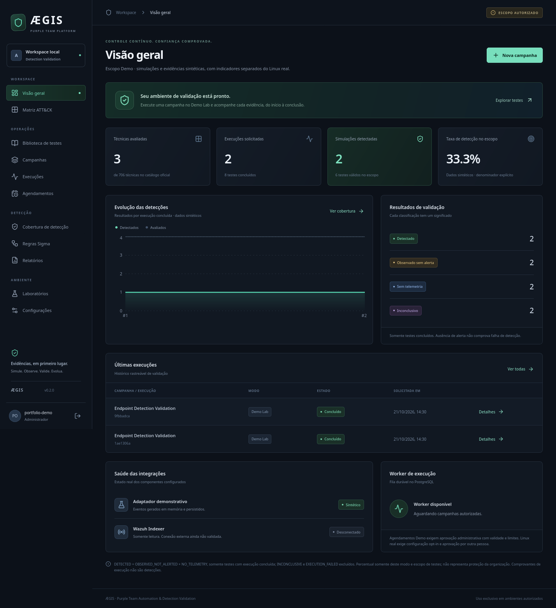
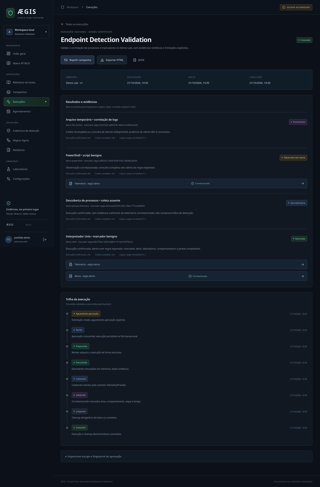
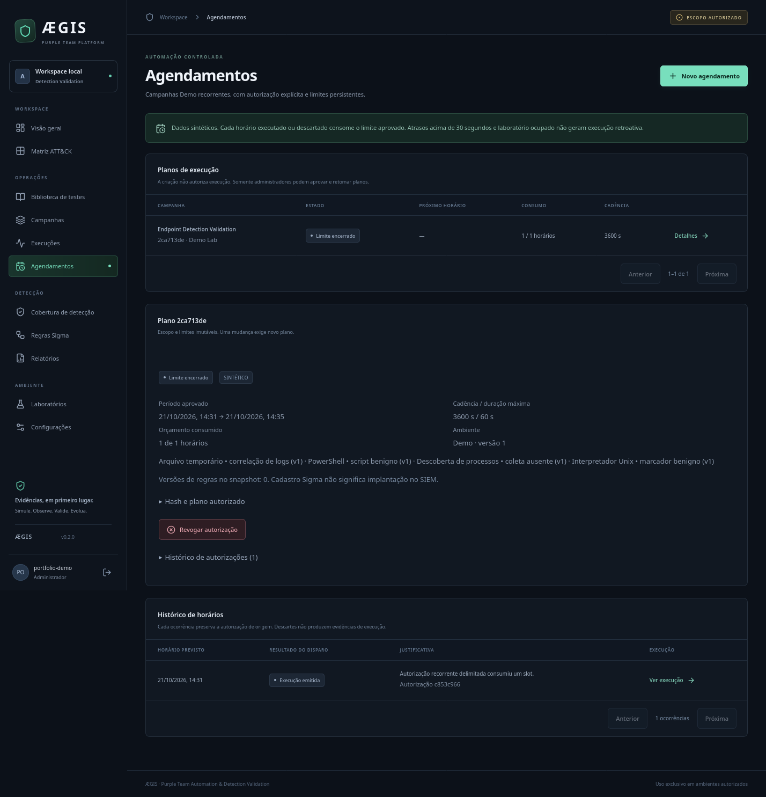
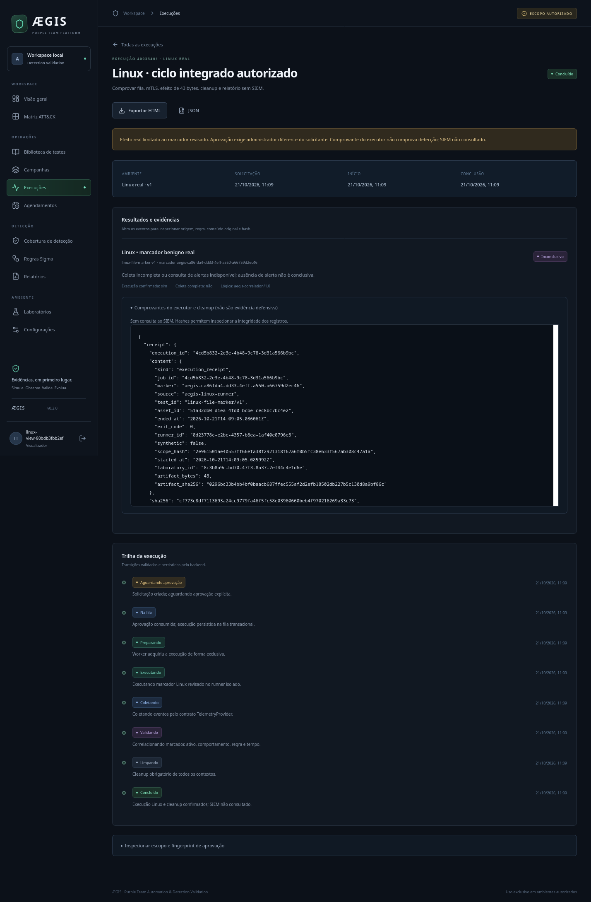
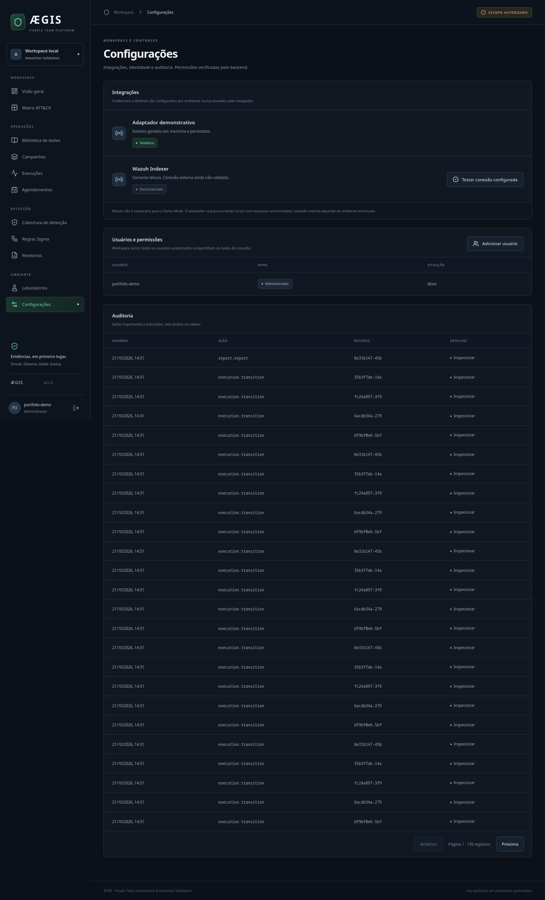
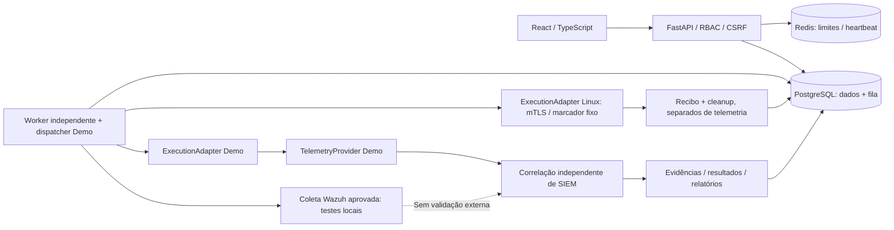

# ÆGIS

**Purple Team Automation & Detection Validation Platform**

Simulações controladas, resultados reproduzíveis e decisões de detecção sustentadas por evidências.

Equipes defensivas precisam verificar se seus controles observam e detectam comportamentos de ataque. O ÆGIS conecta campanhas, aprovação de escopo, execução, coleta, correlação e acompanhamento histórico num único fluxo.

**Estado: 0.2 — Demo persistente e campanhas Linux opt-in validadas localmente.** Demo mantém eventos sintéticos explícitos. Linux admite somente um marcador benigno revisado, com mTLS, aprovação por outra pessoa, recibos e cleanup persistidos. Coleta Wazuh preparada e testada localmente, **sem instalação nem validação Wazuh externa**; Atomic Red Team não executa. Não é um SIEM, EDR ou shell remoto.



## O que funciona

- Login local com Argon2id, sessões opacas, CSRF, RBAC e limite distribuído de tentativas.
- Catálogo oficial Enterprise ATT&CK 20.0: 706 técnicas/subtécnicas ativas, pesquisa, filtros, tabela, matriz e histórico de avaliações.
- Quatro simulações em allowlist demonstrativa, com requisitos, comportamento e cleanup definidos. Arquivo marcador genérico não recebe técnica ATT&CK artificial.
- Campanhas de escopo imutável, solicitações idempotentes, aprovação administrativa de uso único, expiração, confirmação de início e limite de duração.
- Worker independente, fila transacional PostgreSQL, claim exclusivo, cancelamento cooperativo, cleanup e recuperação de execuções abandonadas.
- Agendamentos Demo com aprovação explícita, validade, duração, limite de horários, pausa/revogação e histórico de autorizações.
- Eventos originais, hashes SHA-256, justificativas de correlação, evidências inspecionáveis e auditoria.
- Dashboard e métricas da API, denominadores explícitos, comparação de duas execuções e exportação HTML/JSON.
- Inventário Sigma com parsing pySigma, importação YAML limitada e versões imutáveis; nenhuma implantação automática de regras.
- Runner Linux opt-in com um teste marcador benigno, mTLS, subprocesso supervisionado, lease, diário/fencing persistente e cleanup restrito; campanha integrada autorizada validou API/worker/SQL runtime, recibos, cleanup e UI, sem SIEM.
- Coleta Wazuh opt-in no worker: binding administrativo de agente/regra, política/hash aprovados, polling com prazo integral, paginação, resumo imutável e UI/relatórios. Testes locais incluem TLS real em loopback e fixtures de eventos. **Wazuh não instalado nem validado externamente.**

## Início rápido

Requisitos: Docker Engine com Compose, Git, Python 3 para gerar a configuração local; acesso à internet no primeiro build. Nenhuma instalação de Wazuh é necessária.

```bash
git clone git@github.com:Buraddomoon/AEGIS.git aegis
cd aegis
make up
make bootstrap
```

O repositório é **privado**; o clone exige acesso autorizado. `make up` gera segredos aleatórios em `.env` (0600), constrói a SPA/API, aplica migrações, faz seed e inicia PostgreSQL, Redis e worker. `make bootstrap` solicita usuário e senha no terminal, sem conta administrativa publicada.

Abra **http://localhost:18780**. Se não houver Make: execute `python3 scripts/init_env.py`, `docker compose up -d --build` e `docker compose run --rm migrate python -m aegis.cli bootstrap`.

Para parar, `make down`. O volume do banco é preservado. Recursos configurados: limites de memória por serviço no Compose; consumo real depende do host e não foi usado como benchmark.

## Demonstração reproduzível

1. Autentique com o administrador criado localmente.
2. Abra **Campanhas → Nova campanha**, escolha Demo Lab e os quatro testes.
3. Solicite execução; revise testes, versão do ambiente e fingerprint do escopo.
4. Aprove e depois **Confirme e inicie**. A autorização permite uma única execução e expira.
5. Abra resultados, eventos e evidências; confira `synthetic: true` e os hashes.
6. Consulte cobertura e exporte relatório HTML ou JSON.
7. Repita a campanha, aprove novamente e compare em **Cobertura de detecção**.

Uma campanha com os quatro testes produz, por desenho do adaptador Demo:

| Simulação | Resultado sintético | Interpretação |
|---|---|---|
| Shell Unix benigno | DETECTED | Alerta da regra esperada correlacionado à execução |
| PowerShell benigno | OBSERVED_NOT_ALERTED | Telemetria correlacionada e consulta completa sem alerta esperado |
| Descoberta de processos | NO_TELEMETRY | Execução confirmada, evidência insuficiente de telemetria |
| Marcador temporário | INCONCLUSIVE | Consulta demonstrativamente indisponível |

Isso representa **1 detectado / 3 testes válidos = 33,3% neste escopo sintético**; o inconclusivo é excluído. Não representa 33,3% de proteção de uma organização. Repetir sem alterar o escopo reproduz os mesmos cenários; não simula uma melhoria defensiva inexistente.



Para automatizar: abra **Agendamentos**, crie um plano para a campanha, defina início/fim, intervalo e limite de horários, revise e autorize como administrador. O worker executa automaticamente dentro desses limites. Atrasos acima de 30 segundos e laboratório ocupado geram descartes auditados, consumindo o orçamento sem backlog. Pausar exige nova aprovação para retomar; revogar encerra o plano. [Política e operação](docs/operations/scheduling.md).



## Linux Lab integrado — etapa 3

O ensaio local explicitamente autorizado executou um programa fixo em container isolado: criou, conferiu o hash e removeu um marcador de 43 bytes. O diário preservou um único início após restart e retry. Sem consulta ao SIEM, a classificação foi **INCONCLUSIVE**; o comprovante de execução não é alerta defensivo.

`make lab-init`, `make lab-config` e `make lab-build` preparam PKI/configuração/imagem sem iniciar o laboratório. `make lab-up`, `make lab-preflight`, `make lab-inspect`, `make lab-smoke` e `make lab-down` operam somente esse laboratório, após autorização específica. Não fazem parte do `make up` padrão. [Instalação, escopo, limitações e recuperação](labs/linux/README.md).

O segundo ensaio, autorizado separadamente, percorreu cadastro/revisão → preflight mTLS → autorização do laboratório → solicitação pelo operador → aprovação por outro administrador → fila/worker → marcador → cleanup → relatório. Banco confirmou **uma única campanha real**, resultado INCONCLUSIVE, recibo de 43 bytes, zero eventos/alertas defensivos inventados e reserva liberada. Contas temporárias foram desativadas; laboratório revogado e containers/redes encerrados.

`make linux-platform-config` e `make linux-platform-build` preparam o stack integrado separado. `make linux-platform-up/smoke/down` exigem autorização específica, conforme o [escopo concreto](labs/linux/README.md#escopo-concreto-do-novo-ensaio-integrado). API desse ensaio usa localhost:18785, banco próprio e o runner fixado; o Demo padrão continua em 18780.



## Preparação Wazuh — sem instalar

O próximo fluxo está implementado no código: política de implantação → revisão do binding → escopo de campanha → coleta limitada → evidências/resultado/relatório. O usuário informou não possuir Wazuh; esta entrega usa apenas fixtures e testes locais, sem iniciar o SIEM ou repetir ensaio Linux.

[Guia de preparação](labs/wazuh/README.md) inclui mapping entre agent.id e Asset.id, observador passivo sem executar marcadores, arquivos JSON/XML exemplificados e montagem de configuração. A regra de exemplo valida somente o pipeline de um marcador benigno; não representa cobertura ATT&CK ou proteção empresarial. Agent, compartilhamento read-only do workspace, ingestão/archives e validação com wazuh-logtest continuam pendentes de ambiente/autorização próprios.



## Arquitetura



Monólito modular, sem microsserviços desnecessários. PostgreSQL é fonte de verdade e fila durável (`FOR UPDATE SKIP LOCKED`); Redis não transporta jobs serializados. API e worker usam papel de banco sem privilégios administrativos; evidências, versões Sigma e auditoria têm escrita append-only. [Arquitetura e decisões](docs/architecture/overview.md).

Stack: Python 3.13, FastAPI, Pydantic 2, SQLAlchemy 2, Alembic, psycopg 3, PostgreSQL 17, Redis 8; React, TypeScript, Vite, Tailwind 4, TanStack Query, Recharts e Lucide. Versões efetivas e hashes estão nos lockfiles. [Licenças](THIRD_PARTY_NOTICES.md).

## Desenvolvimento e validação

Requisitos adicionais: Python 3.13, Node 24, npm e Firefox instalado para o E2E. Os locks Python publicados são para Linux x86_64 / CPython 3.13.

```bash
make setup                 # ou make PYTHON=/caminho/python3.13 setup
make infra                 # somente PostgreSQL/Redis locais
make migrate
make test                  # domínio, integração PostgreSQL e componentes React
make test-wazuh            # fixtures de coleta, campanhas, observador e TLS local; sem instalar SIEM
make lint
make build
make audit
make e2e                   # API, worker e schema descartável, navegador real
```

Se estiver usando o Compose completo, pare API/worker (`docker compose stop api worker`) antes de iniciar `make dev-web`, que também utiliza a porta 18780. Para desenvolvimento, em terminais separados: `make dev-api`, `make dev-worker`, `make dev-web`. Bootstrap local: `.venv/bin/python -m aegis.cli bootstrap`; seed local: `.venv/bin/python -m aegis.cli seed`.

Os testes usam schemas PostgreSQL temporários; não truncam o banco da aplicação. E2E usa credenciais aleatórias em memória e schema descartável, executa o worker real e gera as capturas deste README. Sem mocks no fluxo E2E. Consulte [testes e evidências de validação](docs/development/testing.md).

CI executa lint, tipos, testes, build e auditoria, com cache e cancelamento de execuções redundantes. Desenvolvimento exclusivamente em `main`, commits granulares e push direto, conforme política em [AGENTS.md](AGENTS.md).

## Limitações reais

- MVP de workspace único: usuários autenticados compartilham as consultas; não há isolamento multi-tenant, MFA, SSO ou recuperação de senha pela interface.
- Linux real é limitado a um marcador fixo, sem atribuição ATT&CK artificial, Atomic ou comandos genéricos. Recuperação após crash mantém quarentena até cleanup confirmado; rotação de binding/certificado original ainda exige intervenção manual. Demo usa cancelamento cooperativo; Linux supervisiona processo e lease.
- Wazuh foi testado com fixtures locais e HTTPS em loopback, sem SIEM externo. O mapping aprovado e worker estão implementados; agente/instrumentação, compartilhamento do workspace, archives, regras e ingestão reais ainda precisam de ambiente e autorização. Não declarar DETECTED externo com base nas fixtures.
- Sigma validado sintaticamente não equivale a detecção implantada. Associação operacional com testes e conversão de SIEM ficam para próxima etapa.
- Agendamento habilitado somente para Demo: até 16 planos ativos, 100 horários por plano, mínimo 60 segundos de intervalo e validade máxima de 90 dias. Sem cron livre, Lab real, PDF, Caldera ou funções de IA. Relatórios são exportações dos registros persistidos, sem armazenamento de binários no banco.
- Há um aviso transitivo conhecido em DiskCache, exigido pelo pySigma. O caminho de parsing usado não importa/utiliza o cache vulnerável; a revisão e sua verificação estão em [advisories](docs/security/dependency-advisories.json). Não alegamos ausência de vulnerabilidades.
- Instalação padrão é HTTP em loopback. Exposição externa exige TLS, cookie Secure, revisão operacional e gestão própria de segredos. Não anunciar como enterprise-ready.

[Roadmap](docs/product/roadmap.md) · [Critérios de aceite](docs/product/acceptance-criteria.md) · [Progresso e retomada](docs/PROGRESS.md) · [API/OpenAPI](docs/api/overview.md) · [Segurança](SECURITY.md)

## Uso autorizado e licença

Utilize somente em ambientes previamente autorizados. A plataforma não fornece comandos arbitrários, evasão, persistência maliciosa, coleta de credenciais ou exfiltração. Somente os ensaios benignos Linux explicitamente autorizados foram executados; nenhum alvo externo ou Wazuh foi acessado.

Código ÆGIS sob [MIT](LICENSE). Dataset MITRE e bibliotecas mantêm suas próprias licenças. A disponibilidade da licença não altera a visibilidade privada do repositório.
