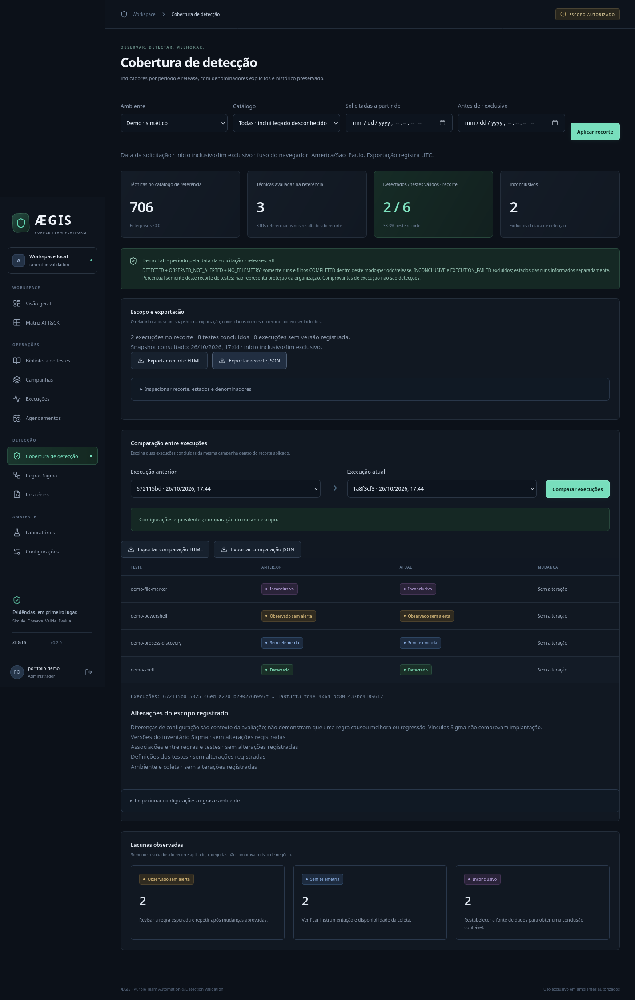
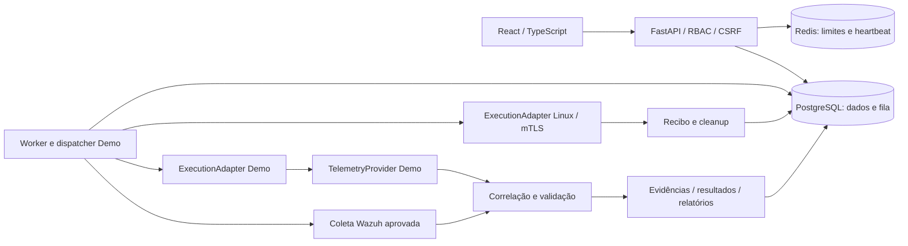

# ÆGIS

**Purple Team Automation & Detection Validation Platform**

Se um comportamento de ataque acontecesse no laboratório, os controles conseguiriam
observá-lo, detectá-lo e demonstrar essa detecção com evidências?

O ÆGIS automatiza esse ciclo: campanha → aprovação de escopo → simulação controlada
→ coleta → correlação → evidências → comparação. O resultado preserva versões,
identificadores e limites da análise, para que outra pessoa consiga verificá-lo.

**Versão do código: 0.2.0.** Demo persistente e funcional; Linux restrito a um
marcador benigno; pipeline Wazuh validado em um ensaio próprio encerrado. O
repositório permanece **privado**. Não é SIEM, EDR ou shell remoto.


## Executar localmente

Ambiente validado: Linux x86_64, Docker Engine com Compose, Make, Git e Python3.13.
O host precisa de acesso ao repositório privado e internet para o primeiro build.
Node/Python de desenvolvimento não são necessários dentro do host para executar
as aplicações em containers; Python no host gera a configuração local.

```bash
git clone git@github.com:Buraddomoon/AEGIS.git aegis
cd aegis
make up
make bootstrap
```

Abra **http://localhost:18780**. O bootstrap solicita seu usuário e senha; não há
credenciais padrão. `make up` gera `.env` privado com segredos aleatórios,
constrói a aplicação, aplica migrações, faz seed e inicia API/worker/PostgreSQL/Redis.
O gerador preserva configurações válidas e recusa arquivos inseguros ou segredos
vazios: **não copie `.env.example` para `.env`**.

Sem Make: `python3 scripts/init_env.py`, `docker compose up -d --build` e
`docker compose run --rm migrate python -m aegis.cli bootstrap`.

Para parar: `make down`, preservando o volume do banco. A API publica somente
loopback18780; banco/Redis não publicam portas no Compose padrão. Não instale
Wazuh para usar o Demo. [Instalação e solução de problemas](docs/operations/deployment.md).

## Demonstração em sete passos

1. Entre com a conta administrativa criada no bootstrap.
2. Em **Campanhas**, crie uma campanha com Demo Lab e os quatro testes.
3. Solicite execução e revise o escopo, a versão do ambiente e o hash.
4. Aprove e confirme o início. Cada aprovação permite uma única execução.
5. Abra os resultados e inspecione eventos, evidências, justificativas e hashes.
6. Em **Cobertura de detecção**, aplique os filtros e exporte HTML ou JSON.
7. Repita com nova aprovação e compare as duas execuções.

| Teste Demo | Resultado esperado, sintético | Evidência/interpretação |
|---|---|---|
| Shell Unix benigno | DETECTED | Alerta esperado correlacionado ao teste |
| PowerShell benigno | OBSERVED_NOT_ALERTED | Telemetria confirmada, sem alerta correspondente |
| Descoberta de processos | NO_TELEMETRY | Execução confirmada, telemetria insuficiente |
| Marcador temporário | INCONCLUSIVE | Consulta demonstrativamente indisponível |

Os quatro cenários usam adaptadores Demo e persistem dados reais da aplicação,
sempre `synthetic=true`. Nenhum comando PowerShell ou comportamento ofensivo é
executado nesse modo. **1 detectado / 3 testes válidos = 33,3% neste escopo
sintético**; o inconclusivo fica fora do denominador. Esse número não mede a
segurança de uma organização. Repetir o mesmo escopo não inventa melhoria.


## Funcionalidades e limites de validação

| Área | Implementado | Limite |
|---|---|---|
| Identidade | Argon2id, sessões opacas, CSRF, RBAC, rate limit | Workspace único; sem MFA/SSO |
| Campanhas | Escopo/hash imutáveis, aprovação, fila PostgreSQL, cancelamento, timeout, cleanup | Linux exige revisão separada; nenhum comando arbitrário |
| ATT&CK | Fonte oficial Enterprise20.0,706 técnicas/subtécnicas ativas no snapshot inicial; matriz, busca, proveniência e publicação controlada | Catalogado não significa testado; publicação completa inclui retiradas |
| Evidências | Eventos originais, correlação por identidade/marcador/tempo/regra, hashes e histórico | Ausência de alerta não comprova ausência de telemetria |
| Cobertura | Modo/período/release/legado, comparação e HTML/JSON com denominadores | Contexto incompleto bloqueia equivalência; delta não comprova causalidade |
| Sigma | Parsing pySigma, versões, vínculos revisados, análise estática e diagnóstico de preparação | Conversão/implantação bloqueadas sem backend/pipeline compatíveis |
| Agendamentos | Grants delimitados, limite de ocorrências, pausa/revogação e auditoria | Somente Demo; mínimo60s, até100horários e90dias por plano |
| Linux | Runner mTLS, programa fixo, supervisão, lease, diário/fencing e recibos/cleanup | Um marcador43bytes; sem técnica ATT&CK atribuída artificialmente |
| Wazuh | Indexer somente leitura, TLS, binding agente/regra, paginação e coleta correlacionada | Um ensaio Linux/Wazuh4.14.9; sem Windows/archives/outras regras |
| Recuperação | Backup consistente, restore offline, quarentena, reconciliação e novo ciclo Demo em clone | Sem cutover, recuperação entre hosts ou RPO/RTO garantidos |
| Cópia cifrada | age/X25519 opcional host-only, chave separada, restore verificado e plano de retenção | Sem upload/expurgo; originais permanecem em claro; custódia ainda local |



[Galeria de capturas reais e sua origem](docs/images/README.md) ·
[Critérios de aceitação](docs/product/acceptance-criteria.md) ·
[Roadmap](docs/product/roadmap.md)

## Ensaios reais já encerrados

O Linux próprio validou um marcador de43bytes, cleanup e idempotência; o recibo
sem SIEM foi classificado **INCONCLUSIVE**, sem inventar alerta.
[Escopo, instalação e limites](labs/linux/README.md).

Em2026-10-22, uma campanha separada percorreu marcador → observador passivo →
agente001 → manager/regra100200 → FilebeatTLS → Indexer → correlação → relatório:
**COMPLETED / DETECTED / CLEANED, synthetic=false**. Foram avaliados **um teste e
zero técnicas ATT&CK**. A regra confirma a instrumentação desse marcador; não
comprova eficácia de EDR ou proteção empresarial.
[Alerta original, hashes e encerramento](docs/evidence/wazuh-2026-10-22/README.md).

As autorizações foram consumidas: containers/redes encerrados, laboratórios
revogados, contas temporárias desativadas e volumes/journals preservados. Os dados
reais não foram inseridos no Demo. Um novo ensaio exige escopo e autorização
específicos; `make up`, testes e CI não iniciam esses laboratórios.

## Arquitetura



Monólito modular com worker independente. PostgreSQL guarda a fila transacional
(`FOR UPDATE SKIP LOCKED`); Redis atende rate limit e heartbeat, sem serializar
jobs. API/worker usam papel SQL sem privilégios administrativos; auditoria,
evidências e versões preservam histórico append-only. Integrações seguem contratos
independentes do SIEM. Ferramentas de backup operam apenas no host.
[Arquitetura](docs/architecture/overview.md) · [ADRs](docs/architecture/decisions) ·
[API/OpenAPI](docs/api/overview.md).

Python3.13, FastAPI, Pydantic2, SQLAlchemy2, Alembic, psycopg3, PostgreSQL17,
Redis8; React, TypeScript, Vite, Tailwind4, TanStack Query, Recharts e Lucide.
Versões/hashes estão nos locks. [Licenças e dados de terceiros](THIRD_PARTY_NOTICES.md).

## Desenvolvimento e verificações

Requisitos adicionais: Python3.13, Node24/npm e Firefox para E2E. Locks Python
específicos a CPython3.13/Linuxx86_64; não remover hashes para contornar outra plataforma.

```bash
make setup                 # aceita PYTHON=/caminho/python3.13
make infra                 # PostgreSQL/Redis próprios em loopback18782/18783
make migrate
make test                  # domínio, PostgreSQL e React
make lint
make build
make audit
make e2e                   # navegador/API/worker reais; schema descartável
make release-check         # versões, links locais, cabeçalhos PNG e padrões de segredos
```

Não execute suítes que compartilham RedisDB15 simultaneamente. Testes não truncam
as tabelas da aplicação. O E2E usa schema e credenciais temporários e produz as
capturas Demo. O Compose completo e `make dev-web` disputam18780; siga a
[configuração de desenvolvimento](docs/development/setup.md).

CI principal valida lint/tipos, PostgreSQL/React, build e auditoria, com cache e
cancelamento de runs redundantes. Uma revisão de fonte separada confere mudanças
de documentação sem instalar dependências nem bancos. `release-check` lê o índice
Git; não substitui testes, auditoria, revisão humana ou ensaio de instalação.
[Evidências de entrega](docs/operations/release.md) · [Testes](docs/development/testing.md).

## Operação e limitações

- Padrão local HTTP/loopback. Exposição externa requer TLS, cookies Secure e revisão
  de proxy, segredos e operação. Sem isolamento multi-tenant ou recuperação de senha na UI.
- DiskCache transitivo do pySigma tem advisory revisado e ainda visível. O caminho
  de parsing utilizado não carrega o cache; não alegamos zero vulnerabilidades.
  [Revisão e premissa testada](docs/security/dependency-advisories.json).
- Sigma sem backend/pipeline compatível permanece bloqueado; Atomic importa somente
  metadados. Windows, PDF, Caldera, outros SIEMs/EDRs e IA permanecem roadmap.
- Backup não recupera automaticamente configuração, segredos, imagens ou journals
  dos laboratórios. Chave/ciphertext no mesmo computador não protegem contra perda
  do host. Destino externo foi adiado; nenhuma cópia foi enviada.
  [Backup/restore](docs/operations/backup-recovery.md) ·
  [Criptografia e custódia](docs/operations/encrypted-backups.md).
- Sem garantia de desempenho, alta disponibilidade ou maturidade enterprise-ready.
  [Progresso e retomada](docs/PROGRESS.md) registra testes efetivamente executados.

## Uso autorizado e licença

Use apenas em ambientes previamente autorizados. Sem shell remoto, evasão,
persistência maliciosa, roubo de credenciais ou exfiltração. Nenhuma infraestrutura
empresarial ou alvo externo foi utilizado nos ensaios.

Código sob [MIT](LICENSE); dados MITRE e dependências mantêm suas próprias licenças.
Isso não altera a visibilidade privada. [Contribuição](CONTRIBUTING.md) ·
[Política de segurança](SECURITY.md) · [Regras para agentes](AGENTS.md).
