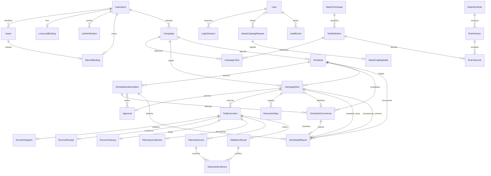

# Modelo de dados 0.2

Entidades implementadas nas migrações, com IDs UUID, índices, FKs e timestamps UTC:

Papéis são enumeração com CHECK no usuário, sem tabela artificial de permissões. Relação campanha/teste e evidência/resultado é relacional. Táticas/plataformas usam arrays PostgreSQL de strings. JSONB guarda snapshots tipados de protocolos/escopos, payload original, detalhes de auditoria e o documento externo imutável do catálogo; não substitui relacionamentos.

Unicidade: usuário; token de sessão (hash); ID externo de ativo; STIX ID; chave de idempotência por solicitante; aprovação por run; teste por run; marcador; evento por execução/origem/ID; resultado por execução; versão por regra. `active_run_id` é uma reserva controlada por transação e bloqueio da linha do laboratório, sem exclusão automática de registros históricos.

As datas são `timestamptz`; apresentação usa o fuso do navegador. Comparações usam versões de testes, regras, ambiente e parâmetros registrados no snapshot. Mudanças posteriores de Sigma não reescrevem resultados. Hashes asseguram verificação de conteúdo, não assinatura ou garantia contra administrador do banco.

Relatórios sob demanda e cobertura são projeções dos dados persistidos. Schedule,
ScheduleAuthorization e ScheduleOccurrence possuem constraints, contadores e
histórico. Unicidade por plano/horário, run por ocorrência e uma autorização não
revogada por plano impedem duplicação. Planos preservam scope/plan hashes;
aprovações derivadas mantêm FK ao grant exato. ScheduledReport acrescenta a fila
transacional e o snapshot automático real: FKs de plano/grant/ocorrência/run/par,
estado/tentativas e documento JSON exportável com SHA256. Identidades e estados
finais são imutáveis; não substitui eventos/resultados relacionais. Não há tabela
artificial de CoverageSnapshot. Conector é configuração de implantação, sem
cadastro de URLs arbitrárias via API. [Contrato](../operations/scheduled-reports.md).

Retenção inicial: não há expurgo automático. Históricos e auditoria são mantidos; limitação de disco deve ser acompanhada. `make clean-demo` remove somente campanhas/resultados sintéticos, e planos Demo encerrados, exigindo revogar planos abertos e finalizar reservas, com confirmação local, e preserva auditoria/usuários/catalogação. Sessões vencidas deixam de autenticar, mas ainda não são expurgadas automaticamente. Antes de operar Lab Mode, definir política de retenção e arquivo externo de evidências.

Linux: binding com runner único, revisão e hash da configuração pública; verificações append-only com validade e versão do ambiente. Dispatch único por execução persiste spec/hash antes da rede; somente generation pode receber UPDATE no papel runtime. Recibo e cleanup únicos por execução são append-only, com comparação de hash e conteúdo em retries. JSON contém mensagens tipadas do protocolo, não comandos arbitrários. Estes comprovantes não são TelemetryEvent nem DetectionEvidence. Migração d4465b7aca2a preserva registros Demo existentes.

Migração 4b72c7bb8548: WazuhBinding relaciona laboratório/ativo ao agent.id externo único, regra, schema, revisão e hash de configuração. TelemetryCollection é resumo imutável por execução, separado dos documentos originais; contém tentativas/período, disponibilidade/completude/janela e razão pública. Runtime não recebe UPDATE/DELETE em resumos. Payloads de eventos mantêm identificadores originais; policy snapshots guardam mapping usado historicamente, mesmo após remover o vínculo atual.

Migrações ec3020ae8711/977fd0c42ae8: RuleTestLink fixa versão/hash Sigma (via FK composta), versão do teste, justificativa e responsável. Índice parcial garante um vínculo ativo por par regra/teste. Somente primeira retirada é permitida por trigger; versões/autores/justificativas e retiradas anteriores não recebem UPDATE nem DELETE. Scopes novos guardam snapshots ordenados dos vínculos relevantes; ausência do campo em histórico antigo é contexto desconhecido. Associação não participa dos veredictos de detecção.

Migração a0d9c7e21b45: AttackCatalogRelease preserva documento/hash canônico,
origem/commit/hashes da fonte/licença e atribuição. Trigger recusa UPDATE/DELETE;
runtime só tem SELECT. AttackCatalogState é singleton com CHECK id=1 e FK para
release vigente. AttackTechnique continua projeção relacional com flags
revoked/deprecated/present_in_current e source_modified preservado da fonte.
Ausentes conservam a versão/metadados anteriores e referências; não são apagadas.
O seed inicializa proveniência conhecida sem reescrever scopes históricos.
Novos scopes incluem release e snapshots das técnicas, mantendo aprovações
vinculadas ao hash. Backup recalcula também a identidade de documentos do catálogo.
