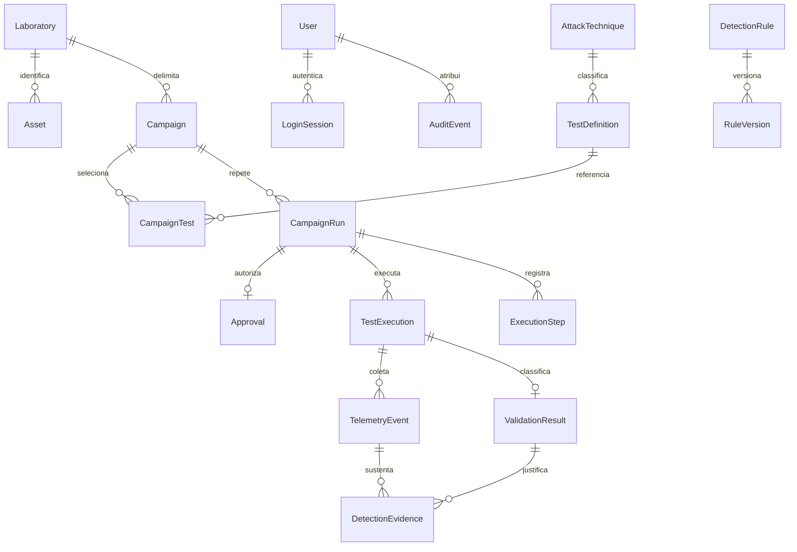

# Modelo de dados 0.1

Entidades implementadas nas migrações, com IDs UUID, índices, FKs e timestamps UTC:

Papéis são enumeração com CHECK no usuário, sem tabela artificial de permissões. Relação campanha/teste e evidência/resultado é relacional. Táticas/plataformas usam arrays PostgreSQL de strings. JSONB está restrito ao snapshot de escopo, payload original e detalhes de auditoria.

Unicidade: usuário; token de sessão (hash); ID externo de ativo; STIX ID; chave de idempotência por solicitante; aprovação por run; teste por run; marcador; evento por execução/origem/ID; resultado por execução; versão por regra. `active_run_id` é uma reserva controlada por transação e bloqueio da linha do laboratório, sem exclusão automática de registros históricos.

As datas são `timestamptz`; apresentação usa o fuso do navegador. Comparações usam versões de testes, regras, ambiente e parâmetros registrados no snapshot. Mudanças posteriores de Sigma não reescrevem resultados. Hashes asseguram verificação de conteúdo, não assinatura ou garantia contra administrador do banco.

Relatórios e cobertura são projeções dos dados persistidos. Não existem tabelas fictícias de Schedule, Report ou CoverageSnapshot. Essas entidades só serão adicionadas quando houver operação/retencão que as justifique. Conector é configuração de implantação, não cadastro de URLs arbitrárias via API.

Retenção inicial: não há expurgo automático. Históricos e auditoria são mantidos; limitação de disco deve ser acompanhada. `make clean-demo` remove somente campanhas/resultados sintéticos, com confirmação local, e preserva auditoria/usuários/catalogação. Sessões vencidas deixam de autenticar, mas ainda não são expurgadas automaticamente. Antes de operar Lab Mode, definir política de retenção e arquivo externo de evidências.
