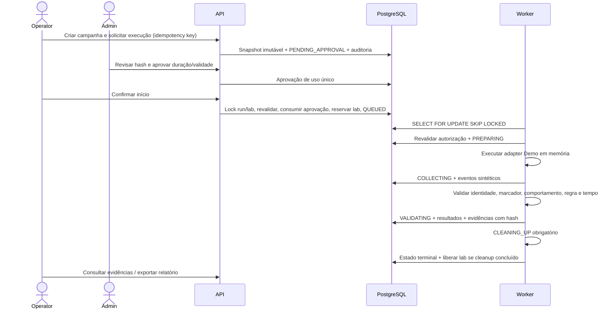
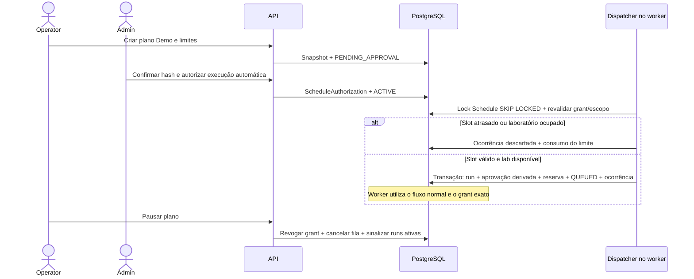

# Fluxo transacional

Não há envio paralelo PostgreSQL/Redis de jobs. Redis indisponível impede novos logins e sinalização de heartbeat, mas não perde jobs persistidos. Apenas testes de um laboratório podem estar reservados por vez. Mais de um worker pode reclamar laboratórios diferentes.

A máquina de estados e as transições permitidas estão em `domain/states.py`. Cancelamento de item em execução passa por cleanup; itens ainda não iniciados podem ser cancelados diretamente. Falha de cleanup mantém a reserva até revisão administrativa. Recuperação de worker interrompido só descarta contextos sintéticos, marca timeout e nunca repete efeitos desconhecidos.

## Emissão agendada

Dispatcher usa sessão SQL própria em thread leve. Planos pausados só retomam mediante nova autorização; contador e calendário são preservados. Grants antigos não são substituídos em runs existentes.
