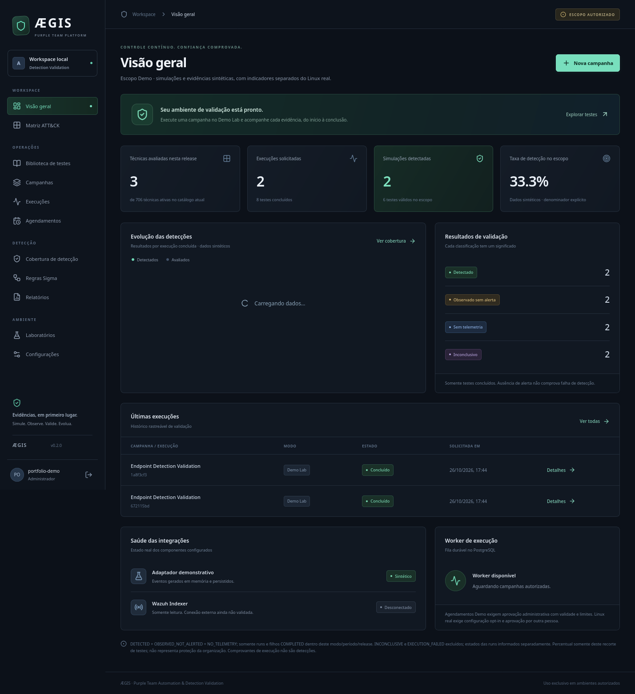
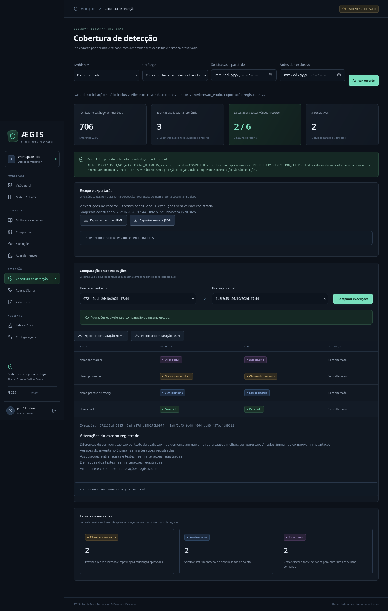
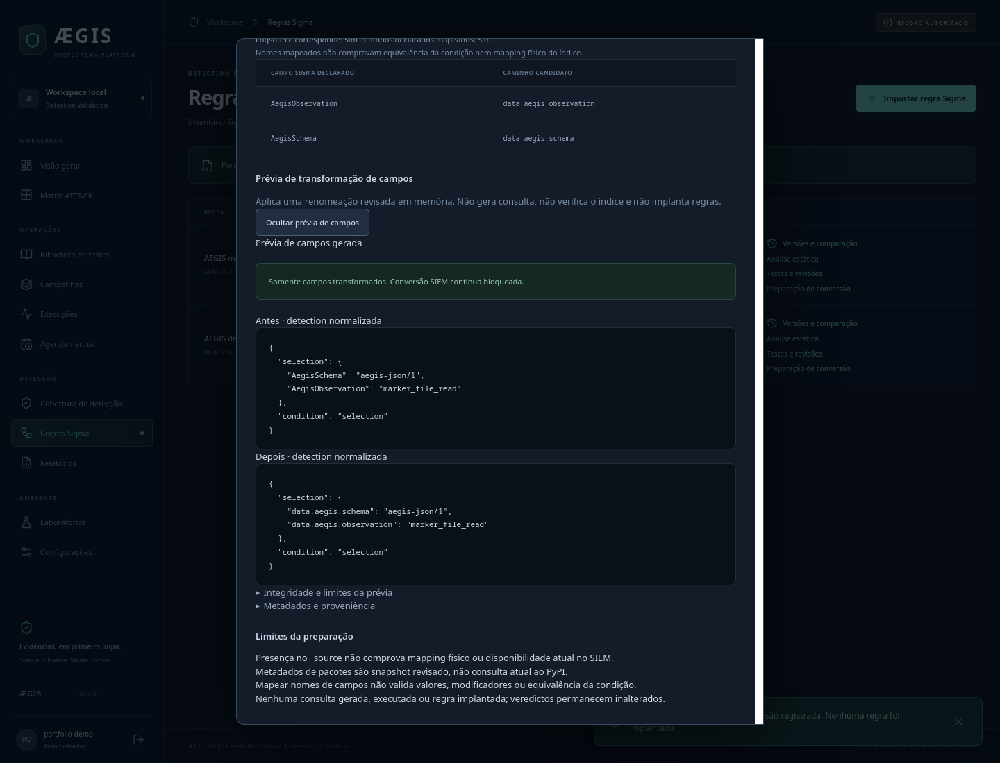
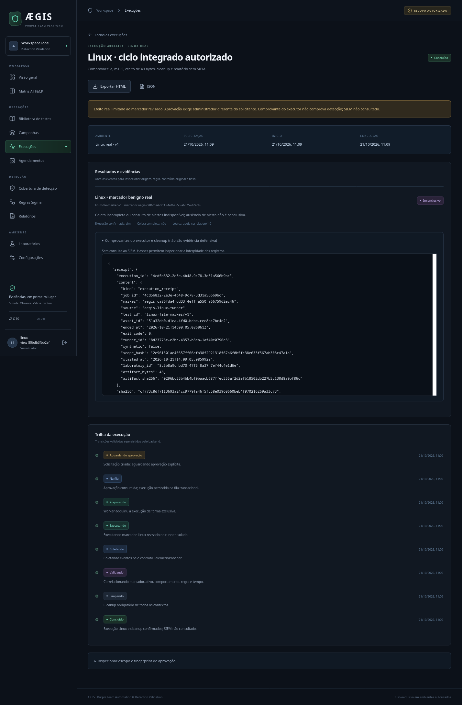

# Galeria de capturas reais

Capturas da interface executável, sem mockups. Os nomes abaixo apontam para os
arquivos originais versionados. Dados Demo vêm da API/worker/PostgreSQL reais no
schema E2E descartável; eventos/alertas desse adaptador são **sintéticos**. Nenhuma
imagem de Demo prova uma detecção externa.

As 13 capturas Demo foram geradas por `scripts/e2e.py` e `apps/web/e2e.mjs` no fluxo
Firefox de 2026-10-26: 4 runs / 16 testes sintéticos, zero erros JavaScript e viewport de 390 px
sem overflow, incluindo o modal de transformação. A rodada atual acrescentou a
prévia oficial de rename e preservou o relatório histórico. São14arquivos com a
captura Linux anterior; nenhuma nova execução real de laboratório.
[Política e limites da prévia](../integrations/sigma.md#prévia-de-transformação-de-campos).

| Captura | Conteúdo e origem |
|---|---|
| [Overview](overview.png) | Indicadores Demo, denominadores e histórico da API |
| [Execução](execution.png) | Classificações sintéticas e evidências inspecionáveis |
| [Cobertura](coverage.png) | Filtros de período/release e exportação do recorte |
| [ATT&CK](attack.png) | Matriz de catálogo oficial, sem inferir técnicas testadas |
| [Catálogo](attack-catalog.png) | Proveniência e histórico do snapshot inicial |
| [Agendamentos](schedules.png) | Plano Demo aprovado e ocorrência emitida pelo worker |
| [Revisões](rule-test-links.png) | Associação de versão Sigma/teste; não é implantação |
| [Comparação](scope-comparison.png) | Diferenças de versões e vínculos registrados nos scopes |
| [Análise Sigma](sigma-analysis.png) | Achado estático parcial em regra demonstrativa |
| [Preparação Sigma](sigma-readiness.png) | Campos candidatos com conversão explicitamente bloqueada |
| [Prévia de campos](sigma-mapping.png) | Transformação oficial real em memória, antes/depois normalizados; nenhuma consulta SIEM gerada |
| [Wazuh desconectado](wazuh-preparation.png) | Demo padrão sem conector; não representa o banco do ensaio Wazuh |
| [Mobile](mobile.png) | Interface Demo em viewport móvel; screenshot pode excluir a barra de rolagem |
| [Linux encerrado](linux-execution.png) | Captura histórica de 2026-10-21: campanha real autorizada, INCONCLUSIVE sem SIEM, recibo separado de detecção |

A imagem Linux foi capturada consultando o histórico após o único ensaio integrado,
sem repetir o marcador. Ver [escopo e encerramento](../../labs/linux/README.md).
O [ensaio Wazuh](../evidence/wazuh-2026-10-22/README.md) possui eventos/evidências
registrados e não ganhou uma screenshot fictícia ou um novo efeito para ilustração.

`make release-check` confere presença no índice Git e cabeçalho/dimensões PNG.
Essa checagem não verifica pixels, procedência ou ausência de informação sensível;
revisão humana e evidências do fluxo continuam necessárias. Não exponha capturas
com dados empresariais ou segredos. Para regenerar Demo use `make e2e`; ensaios
reais Linux/Wazuh exigem autorização específica própria.
