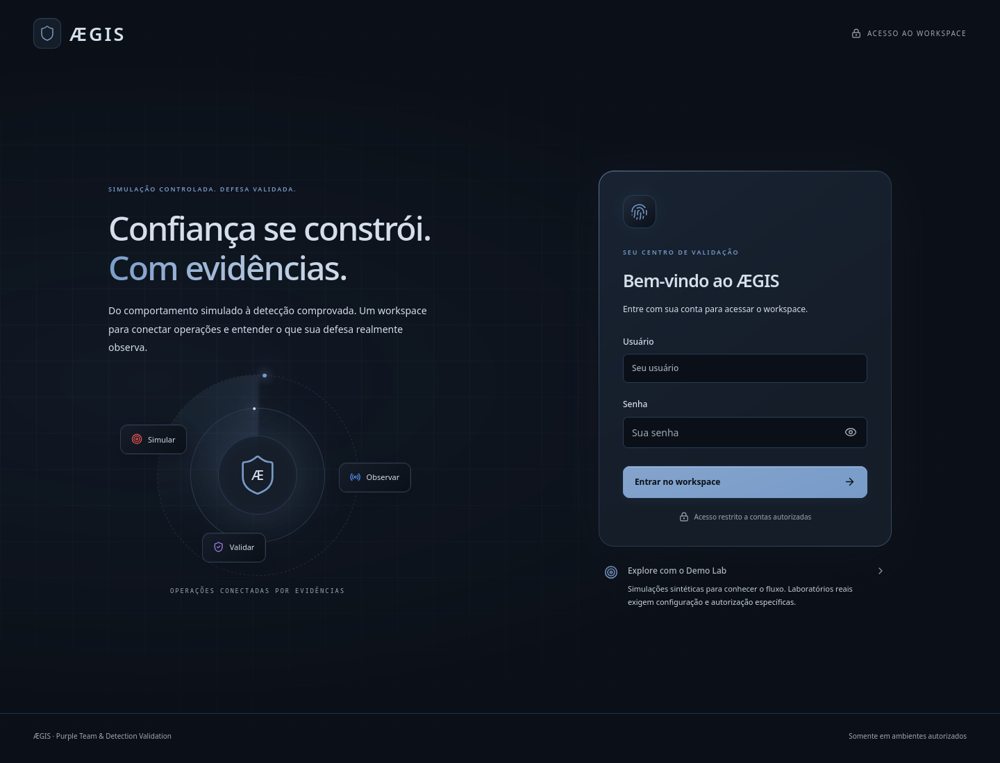
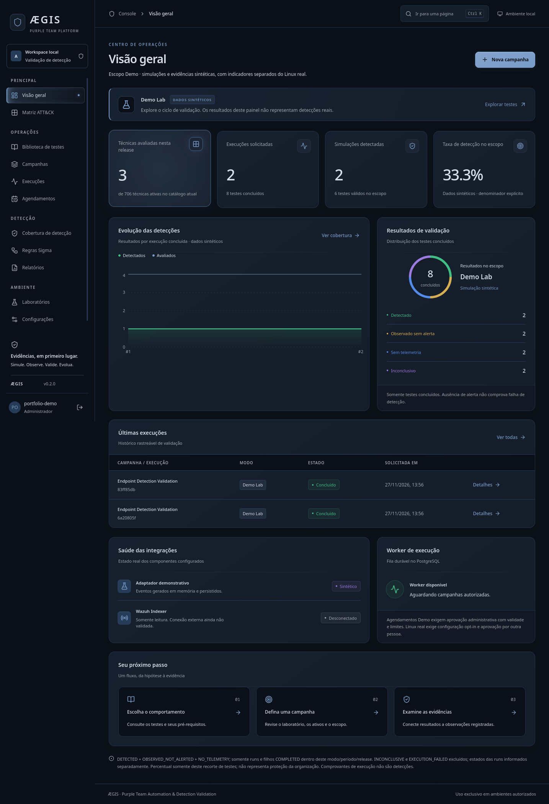
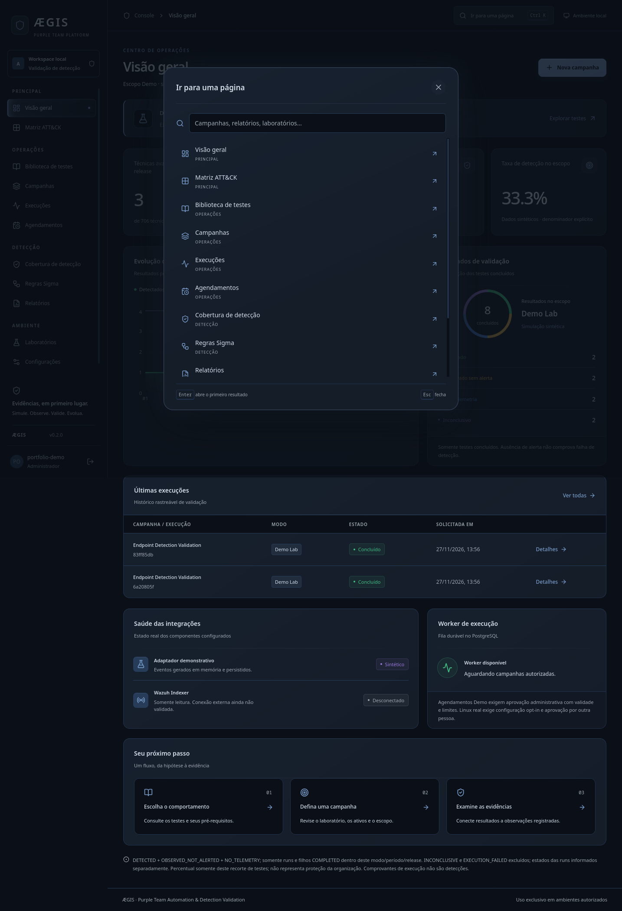
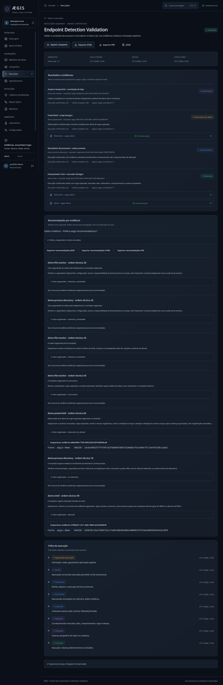
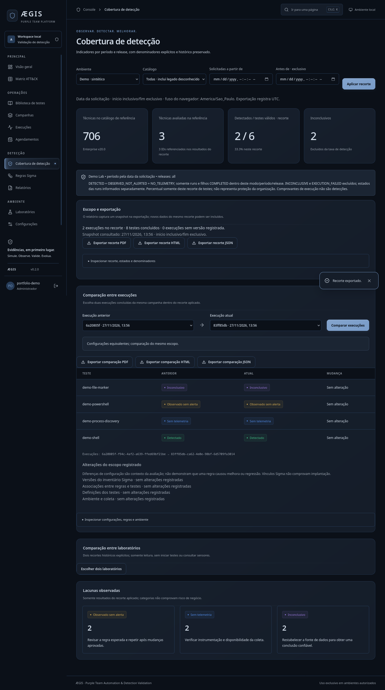

# Galeria da interface AEGIS

Capturas de 27/11/2026 com a paleta AEGIS, superfícies iluminadas, modais suaves e
login animado. São screenshots da aplicação executável em Firefox, com API,
worker, PostgreSQL e Redis em schema E2E descartável. Os dados e evidências do
Demo são **sintéticos**. As imagens não contêm credenciais e não demonstram
uma detecção externa.

A fonte da aplicação é `606879f`, incluindo o visual de `24f87ce` e `43c5a15`.
As capturas são reproduzidas por [e2e.py](../../scripts/e2e.py) e
[e2e.mjs](../../apps/web/e2e.mjs). O fluxo verifica 5 runs e 20 testes sintéticos,
5 exportações PDF, 2 relatórios automáticos e zero erros JavaScript. As 22 capturas de
Firefox usam 1440 px no desktop e 390 px no móvel. A primeira página de um PDF
real exportado completa o conjunto atual com 23 imagens.

O [guia do frontend](../development/frontend-design.md) descreve as interações e
a preferência de movimento reduzido. Uma imagem estática mostra um instante da
animação: os anéis do login giram, os blocos flutuam e os cards reagem ao mouse
na aplicação em execução.

## Identidade e interação

| Captura | Conteúdo |
| --- | --- |
| [Login](login.png) | Formulário vazio e composição decorativa animada, antes de digitar credenciais |
| [Visão geral](overview.png) | Indicadores, histórico e distribuição dos resultados Demo |
| [Brilho no card](overview-hover.png) | Iluminação acompanhando o cursor e elevação do card |
| [Modal de navegação](navigation-modal.png) | Busca de páginas, cantos suaves e superfície com profundidade |
| [Mobile](mobile.png) | Visão geral em 390 px, com dados do mesmo ciclo sintético |

## Operações e evidências

| Captura | Conteúdo e origem |
| --- | --- |
| [Execução](execution.png) | Classificações sintéticas e evidências inspecionáveis |
| [Recomendações](recommendations.png) | Análise vinculada a fatos e evidências da execução |
| [Recomendações no celular](recommendations-mobile.png) | Mesmo percurso em 390 px |
| [Cobertura](coverage.png) | Filtros de período/release e exportação do recorte |
| [ATT&CK](attack.png) | Matriz do catálogo oficial; catalogado não significa testado |
| [Catálogo](attack-catalog.png) | Proveniência e histórico do snapshot inicial |
| [Metadados Atomic](atomic-metadata.png) | Importação e revisão offline de metadados, sem execução Atomic |
| [Atomic no celular](atomic-metadata-mobile.png) | Inspeção dos mesmos metadados em 390 px |
| [Agendamentos](schedules.png) | Plano Demo aprovado e ocorrência emitida pelo worker |
| [Relatórios automáticos](scheduled-reports.png) | Duas ocorrências aprovadas, snapshot inicial e comparação |
| [Vínculos de regras](rule-test-links.png) | Associação de versão Sigma/teste; não é implantação |
| [Comparação](scope-comparison.png) | Diferenças de versões e vínculos registrados nos escopos |
| [Análise Sigma](sigma-analysis.png) | Achado estático parcial em regra demonstrativa |
| [Preparação Sigma](sigma-readiness.png) | Campos candidatos e condições da conversão |
| [Prévia de campos](sigma-mapping.png) | Transformação oficial em memória, antes/depois normalizados |
| [Consulta offline](sigma-query.png) | Consulta e procedência geradas offline; nenhuma consulta SIEM |
| [Wazuh desconectado](wazuh-preparation.png) | Demo sem conector; não representa um ensaio Wazuh |
| [Relatório PDF](report-pdf.png) | Primeira página do PDF atual de uma execução com 4 simulações; 1 detectado em 3 testes válidos, 1 inconclusivo fora da taxa |

## Capturas históricas

As 16 imagens anteriores foram preservadas byte a byte no
[arquivo anterior à revisão visual](archive/pre-2026-11-27/README.md), junto à
sua descrição original e respectivas datas. Isso inclui o PDF de 09/11 e a
[campanha Linux encerrada de 21/10](archive/pre-2026-11-27/linux-execution.png).
A imagem Linux também permanece no caminho histórico `linux-execution.png`.
Não houve nova execução ou captura nativa Linux/Wazuh nesta revisão visual.

## Reprodução e verificação

`make e2e` usa schema próprio e atualiza as capturas da interface; o diretório pode
ser alterado com `AEGIS_E2E_SCREENSHOTS`. O fluxo fotografa o login antes do
preenchimento, registra o hover e o modal e mantém todos os testes anteriores.
Antes de fotografar páginas longas, o helper aguarda as requisições pendentes,
retorna ao topo e sincroniza a pintura do navegador, preservando o posicionamento
do menu e do cabeçalho fixos. Notificações temporárias são dispensadas sem manter
referências a elementos que podem desaparecer durante a captura.
O PDF é rasterizado a partir do arquivo realmente exportado pelo E2E; ele tem
formatação própria, independente do CSS da aplicação.

`make release-check` confere os links locais e os cabeçalhos/dimensões PNG do
índice Git. Essa checagem não substitui inspeção visual ou comprovação da origem.
Credenciais, logs e PDFs de teste permanecem em `.local`, fora do repositório.
